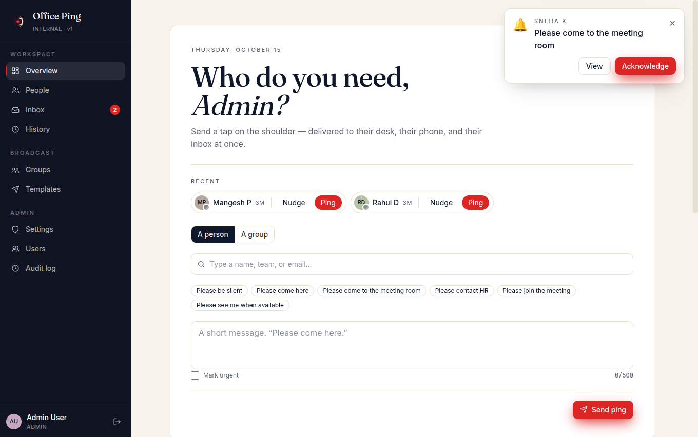
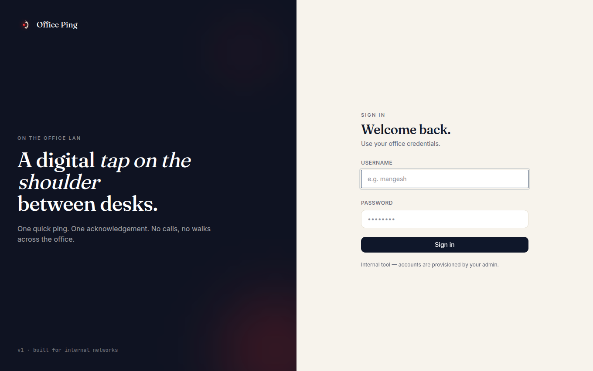
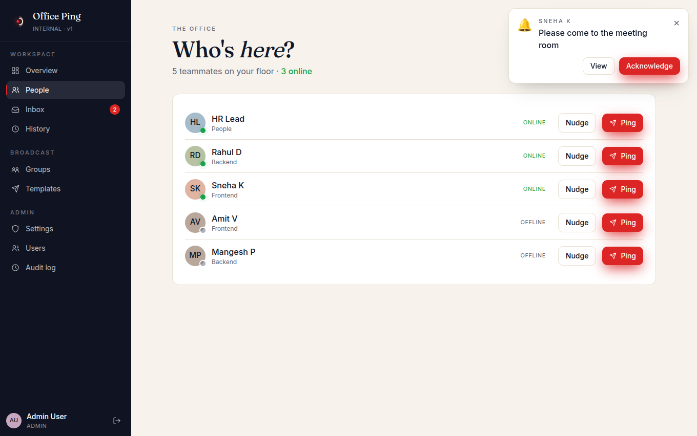
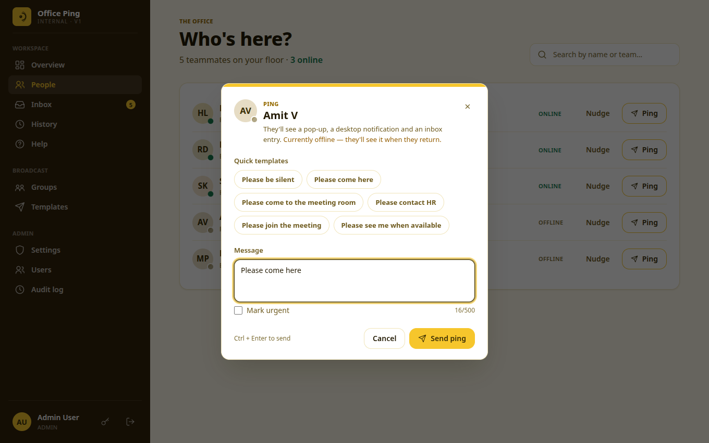
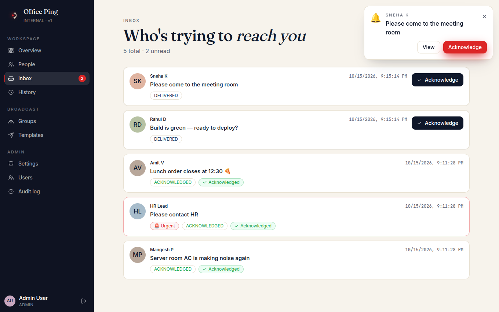
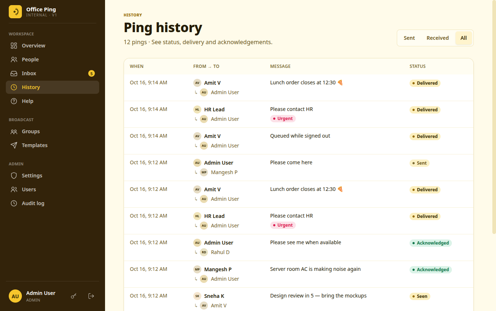
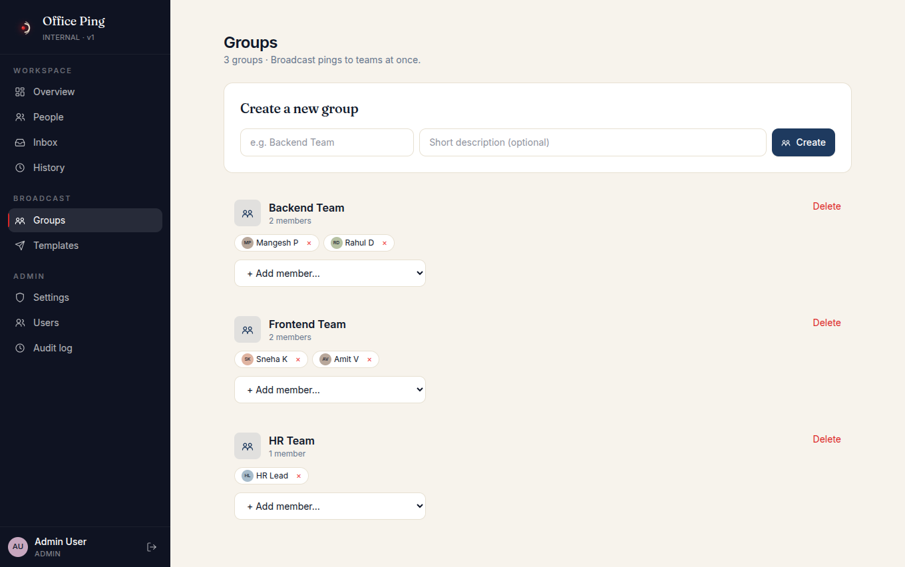
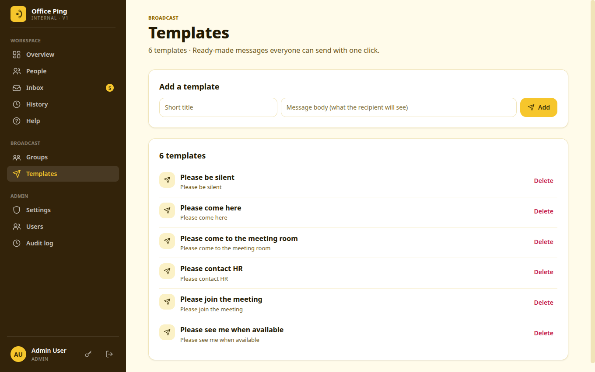
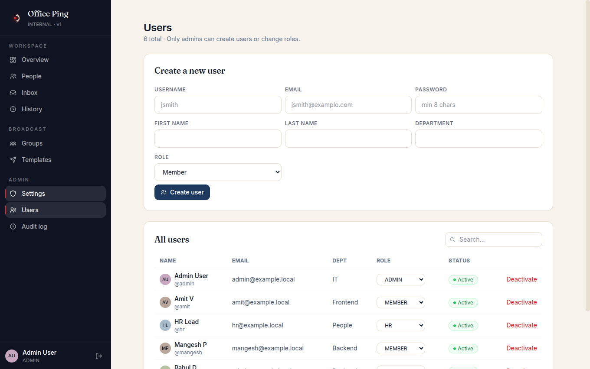
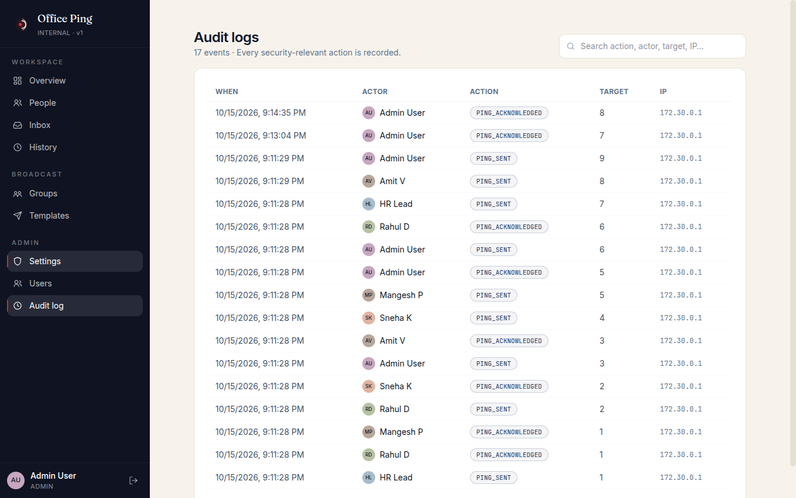

# Office Ping

An internal office notification / ping system for sending targeted alerts
to employees and groups over the office LAN. Supports real-time delivery via
WebSocket, PWA with desktop notifications, and acknowledgement tracking.



## Features

**Pinging**
- **Ping a person or a whole group**: one message reaches every member at once.
- **Nudge**: a one-click "👋 Nudge" for when you just need someone's attention.
- **Quick templates**: canned messages like "Please come to the meeting room", managed by admins.
- **Recent recipients**: the people you pinged last sit on the dashboard for one-tap re-pinging.
- **Urgent priority**: urgent pings are highlighted, play a distinct chime, and pull the recipient straight into their inbox.
- **Rate limiting**: 10 pings/min for members and 60/min for HR and admins, so nobody can spam the office.

**Delivery and acknowledgement**
- **Real-time delivery over WebSocket**: an in-app toast with *View* and *Acknowledge* buttons, a sound, a flashing tab title and an unread badge.
- **Desktop notifications** through the service worker, even when the tab is in the background.
- **Offline-safe**: pings sent while someone is away are delivered as soon as they reconnect.
- **Per-recipient tracking**: every ping moves through *Sent → Delivered → Seen → Acknowledged*, per recipient for group pings.
- **Installable PWA** with its own icons and manifest.

**People and presence**
- **Live presence**: see who is online right now, with a heartbeat-based status.
- **Searchable directory** by name, team or email.

**Administration**
- **Roles**: *Admin*, *HR* and *Member*, with permissions enforced on the server.
- **User management**: create, deactivate and change the role of users from the UI.
- **Passwords**: everyone can change their own password (key icon in the sidebar), and admins can reset a forgotten one with a generated, easy-to-read password.
- **Groups and templates** management.
- **Audit log** of logins, password changes and resets, user/group/template changes, and every ping sent or acknowledged, with actor and IP.
- **Ping history** with filters for *My sent*, *My received* and *All* (HR and admins).

**Deployment**
- **One `docker compose` stack**: Postgres, Redis, Django/Daphne, Next.js and nginx.
- **Built for a LAN**: no external services or cloud accounts needed. See [deployment-lan.md](docs/deployment-lan.md).

## Screenshots

| | |
|---|---|
| **Sign in**<br> | **Dashboard with a live incoming ping**<br> |
| **People and live presence**<br> | **Ping dialog with quick templates**<br> |
| **Inbox**<br> | **History with delivery and ack status**<br> |
| **Groups**<br> | **Templates**<br> |
| **User management (admin)**<br> | **Audit log (admin)**<br> |

*All screenshots use the seeded demo data from `make seed`.*

## Stack

- **Backend:** Django 5, Django REST Framework, Django Channels, PostgreSQL, Redis
- **Frontend:** Next.js 14 (App Router), TypeScript, Tailwind CSS, PWA (service worker)
- **Transport:** REST for CRUD + history, WebSocket (`/ws/notifications/`, `/ws/presence/`) for real-time
- **Infra:** Docker Compose, nginx reverse proxy

## Quick start (dev)

```bash
cp .env.example .env         # edit DJANGO_SECRET_KEY etc.
make setup
make dev
make migrate
make seed
```

Then open `http://localhost:8080` and log in with the seeded demo credentials
(see output of `make seed`).

| User       | Role   |
|------------|--------|
| `admin`    | ADMIN  |
| `hr`       | HR     |
| `mangesh`  | MEMBER |
| `rahul`    | MEMBER |
| `sneha`    | MEMBER |
| `amit`     | MEMBER |

Dev password for all seeded users is printed by `make seed`.

> [!WARNING]
> The demo password is in this public repository. Never run `make seed` on a
> server other people can reach, or change every seeded password straight away
> (`python manage.py changepassword <username>`). For production, create real
> accounts as described in [runbook.md](docs/runbook.md).

## Architecture

```
+----------+   HTTPS   +--------+   HTTP/WS    +---------+
| Browser  | <-------->| nginx  | <----------->| backend | (Daphne, Django+Channels)
| (PWA)    |           +--------+              +----+----+
+----------+               |                        |
                           v                        v
                    +------+-----+            +-----+------+
                    |  frontend  |            | postgres   |
                    |  (Next.js) |            |  redis     |
                    +------------+            +------------+
```

- REST handles auth, users, groups, templates, pings, history, dashboard, audit.
- WebSockets handle presence heartbeats and real-time delivery of pings + status.
- Service worker surfaces OS-level notifications even when the tab is backgrounded.
- Notification delivery goes through a service abstraction so a `WebPushNotifier`
  can be added later without touching ping logic.

See `docs/` for deeper topics:

- [architecture.md](docs/architecture.md)
- [installation.md](docs/installation.md)
- [deployment-lan.md](docs/deployment-lan.md)
- [authentication.md](docs/authentication.md)
- [notifications.md](docs/notifications.md)
- [websocket.md](docs/websocket.md)
- [administration.md](docs/administration.md)
- [troubleshooting.md](docs/troubleshooting.md)

## Tests

```bash
make test
```

## Status / scope

This repository is a production-ready scaffold with all the core workflows
listed in the spec: auth, roles, device registration, presence, individual
and group pings with per-recipient delivery/ack tracking, templates, audit
logs, dashboard, PWA + service worker, Docker/nginx deployment, seed data,
and backend tests covering auth, permissions, pings, groups, templates, and
audit.

Items intentionally **not** included at this stage:

- Web Push (requires VAPID keys and a signed push server; the architecture
  leaves a clean seam for `WebPushNotifier` to be added).
- Playwright E2E tests (configuration provided, scenarios are listed in
  `docs/troubleshooting.md` and the DOD scenarios in the spec).
- Password reset email (code path is documented in `authentication.md`).
- TLS automation (compose exposes `:80`; use `docker-compose.prod.yml` and
  mount certs into nginx for internal HTTPS — see `deployment-lan.md`).
