# Office Ping

[](https://github.com/coderworkbench/office-ping/actions/workflows/ci.yml)
[](LICENSE)

A self-hosted "come here, please" button for an office. Office Ping lets
anyone on the office network send a short, hard-to-miss alert to a person or
a group, see when it was delivered and acknowledged, and chat quietly when it
can wait. It runs as one `docker compose` stack on a LAN server and needs no
cloud accounts, mail server or push service.

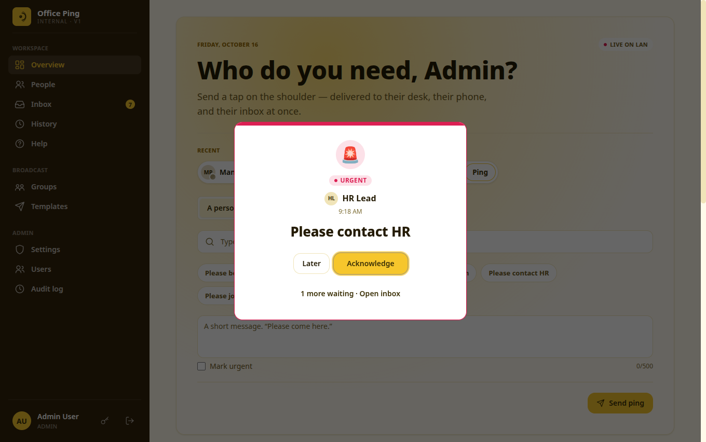

## The problem it solves

In an office without a desk-phone system, "please come to reception" means
walking over, shouting, or hoping a chat message gets read. Office Ping makes
that one click: the recipient's screen shows a pop-up that stays until they
acknowledge it, urgent pings play a distinct alarm and come back if ignored,
and the sender sees *Sent → Delivered → Seen → Acknowledged* for every person.

## Features

**Pinging**
- **Ping a person or a whole group**: one message reaches every member at once.
- **Nudge**: a one-click "👋 Nudge" for when you just need someone's attention.
- **Quick ping from anywhere**: Ctrl+K (⌘K) or `/` opens the composer on any page.
- **Quick templates**: canned messages like "Please come to the meeting room", managed by admins.
- **Recent recipients**: the people you pinged last sit on the dashboard for one-tap re-pinging.
- **Urgent priority**: urgent pings jump to the front, show as a pulsing red pop-up and play a distinct chime. If nobody acknowledges within 5 minutes, the pop-up comes back as a reminder and the sender is told.
- **Rate limiting**: 5 pings a minute per person (a group ping counts once), so nobody can spam the office. Configurable with `PING_RATE` / `PING_RATE_ELEVATED`.
- **No bombarding**: at most 2 pings a minute to the same person, and the same message can't be sent to them twice within a minute (`PING_RATE_PER_RECIPIENT`). Blocked attempts appear in the audit log.

**Delivery and acknowledgement**
- **Hard-to-miss alerts**: an incoming ping opens a pop-up in the middle of the screen that stays until it's acknowledged or put off with *Later*. Several pings queue up, and the tab title keeps flashing while any are waiting.
- **Desktop notifications** through the service worker, even when the tab is in the background. They stay on screen until clicked, clicking one brings Office Ping to the front, and they close by themselves once the ping is handled.
- **Offline-safe**: pings sent while someone is away are delivered as soon as they reconnect.
- **Per-recipient tracking**: every ping moves through *Sent → Delivered → Seen → Acknowledged*, per recipient for group pings.
- **Quick replies**: answer with *On my way*, *Coming in 2 min*, *In a meeting* or *Can't right now*; the sender sees the reply instantly.
- **Tidy inbox**: repeated pings collapse into one row (*👋 Nudge ×8*), and unanswered urgent pings are pinned to the top.
- **Installable PWA** with its own icons and manifest.
- **Opens at sign-in**: one-click setup files for Windows, macOS and Linux (Help → *Open Office Ping automatically at start-up*) open Office Ping in its own window whenever a computer starts.

**Chat**
- **Messages**: quiet one-to-one chat alongside pings. On a computer, a bar in the bottom-right corner opens your chats in small windows; on a phone, Messages has its own tab.
- **Seen and typing…**: read receipts and a typing indicator, live over the same connection as pings.
- **Emoji and reactions**: an emoji picker in the message box, and reactions on any message.
- **Never noisy**: no pop-up or sound, a desktop notification only when the chat isn't in front of you, nothing while you're in a meeting or on Do Not Disturb, and a per-chat mute. Need attention now? **Ping** from inside the chat.
- **Private**: only the two people can read a chat; the audit log records that a chat started, never its content. `CHAT_RATE` limits messages per minute (default 30).

**People and presence**
- **Live presence**: see who is online right now, with a heartbeat-based status.
- **Status and Do Not Disturb**: *In a meeting*, *Do not disturb*, *Out for lunch* or *Away*, with an end time. Senders see it before they ping; in a meeting or DND, normal pings wait quietly in the inbox while urgent ones still break through.
- **Searchable directory** by name, team or email.

**Administration**
- **Roles**: *Admin*, *HR* and *Member*, with permissions enforced on the server.
- **User management**: create, deactivate and change the role of users from the UI.
- **Passwords**: everyone can change their own password, and admins can reset a forgotten one with a generated, easy-to-read password.
- **Groups and templates** management.
- **Audit log** of sign-ins (and failed ones), password changes and resets, user/group/template changes, and every ping sent, acknowledged, escalated or exported, with actor and IP.
- **Ping history** with search and filters (person, dates, status, urgent), *Sent*, *Received* and *All* (HR and admins), plus CSV export for admins.
- **Sign-in protection**: a username locks for 15 minutes after 5 wrong passwords.

**Design**
- **Sunbeam theme**: warm cream, gold accent, Noto Sans.
- **Built-in help**: a Help page with animated, step-by-step demos of each task, and a guided tour that spotlights the real controls.
- **Responsive**: a navigation rail on desktop; on phones and tablets a bottom tab bar, bottom-sheet dialogs and card layouts. Large tap targets, keyboard focus rings and reduced-motion support.

**Deployment**
- **One `docker compose` stack**: Postgres, Redis, Django/Daphne, Next.js, nginx and a small escalation worker.
- **Built for a LAN**: no external services or cloud accounts needed. See [docs/deployment-lan.md](docs/deployment-lan.md).
- **Backups and recovery**: `scripts/backup.sh` (daily via cron) and `scripts/restore.sh` bring everything back on a fresh server; `scripts/fresh-install.sh` starts clean with the repo's templates and a new admin. See [docs/disaster-recovery.md](docs/disaster-recovery.md).

## Screenshots

| | |
|---|---|
| **Incoming ping pop-up (urgent)**<br> | **Dashboard**<br>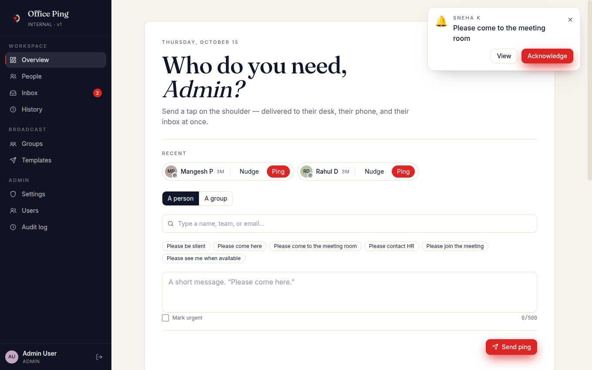 |
| **People and live presence**<br>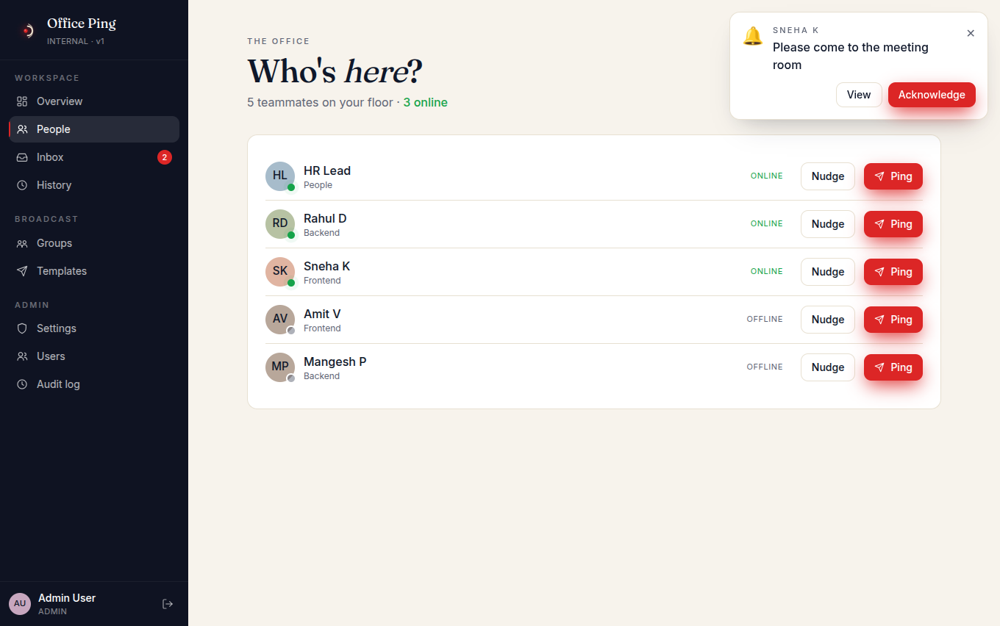 | **Ping dialog with quick templates**<br>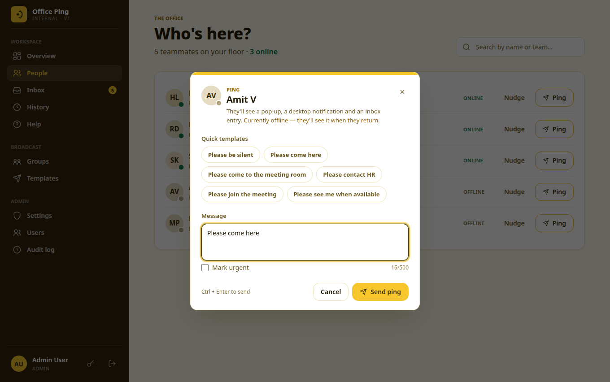 |
| **Inbox**<br>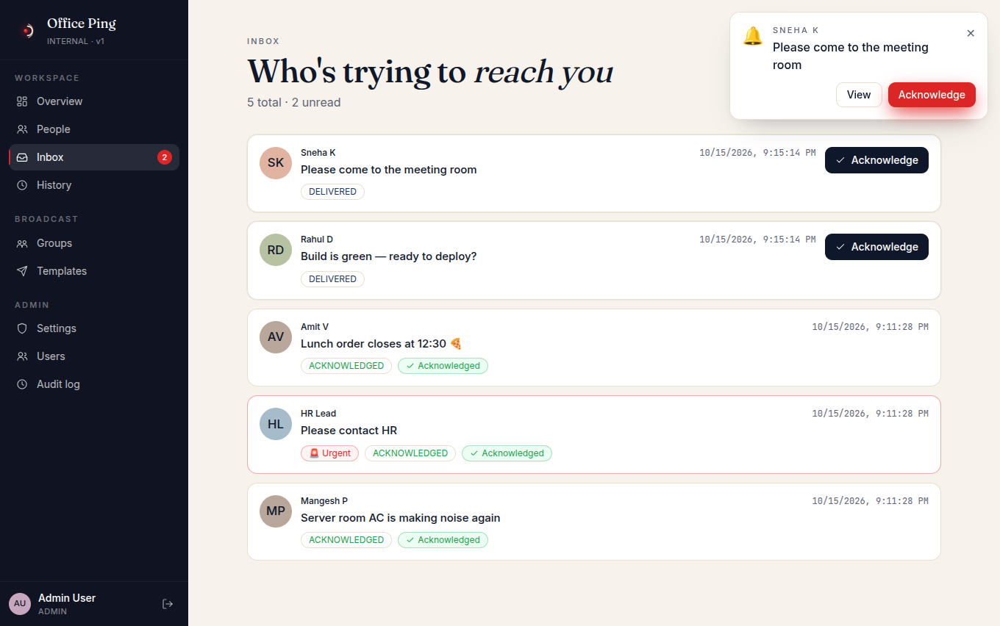 | **History with delivery and ack status**<br>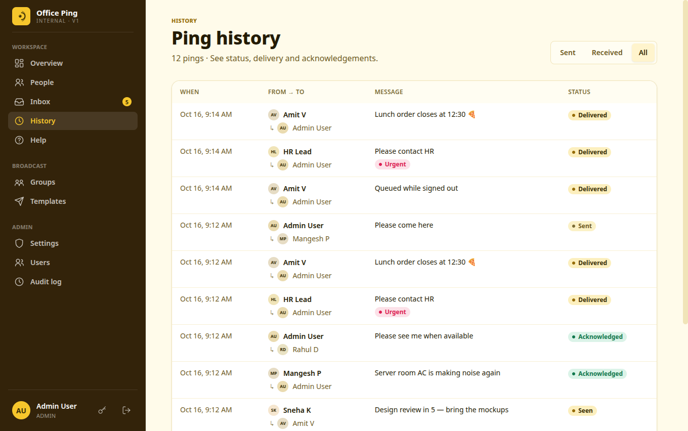 |
| **Groups**<br>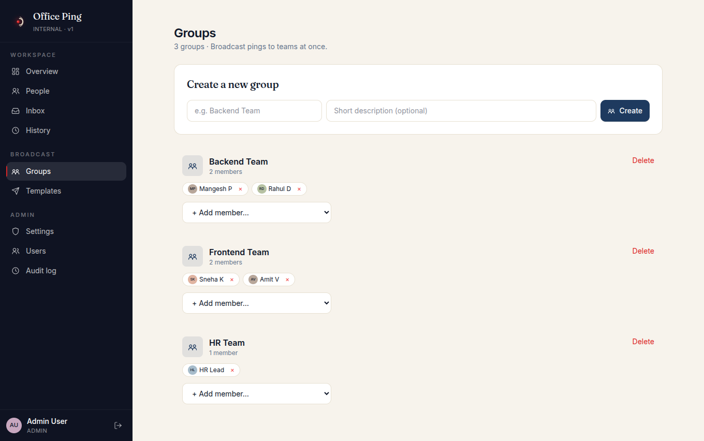 | **Templates**<br>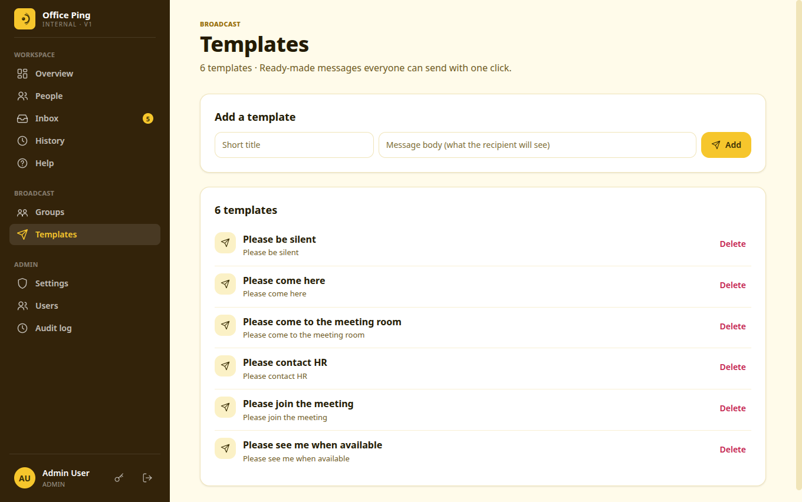 |
| **User management (admin)**<br>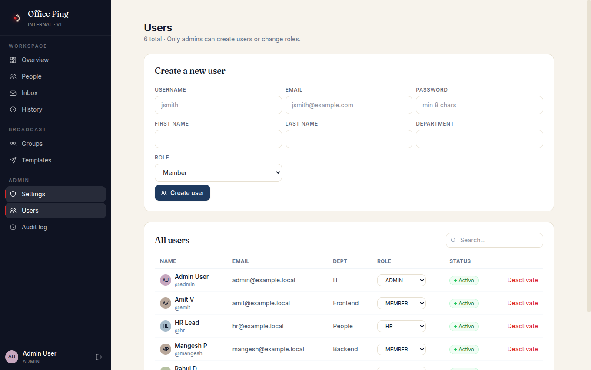 | **Audit log (admin)**<br>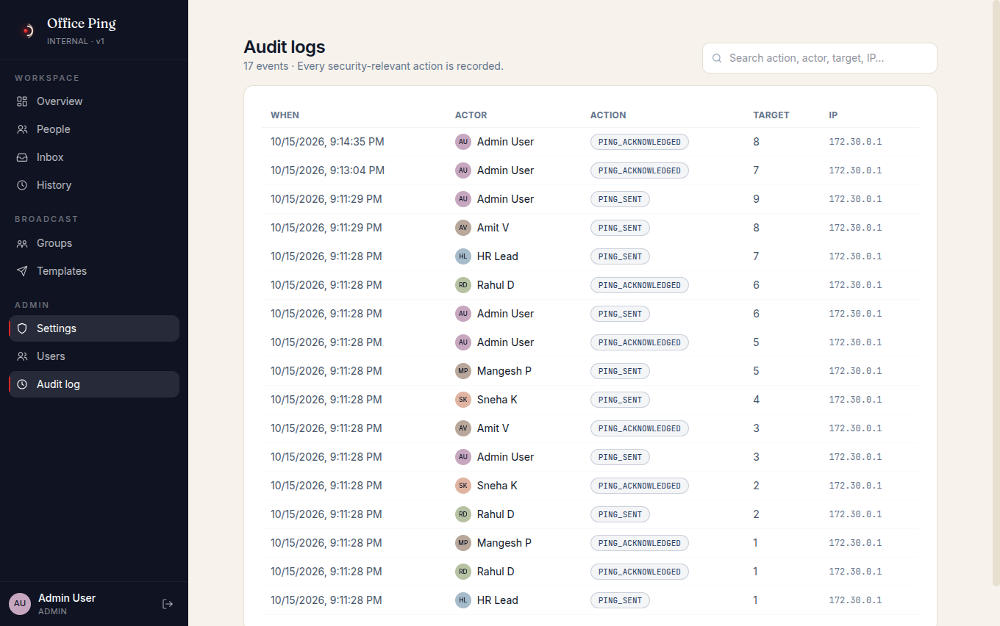 |
| **Sign in**<br>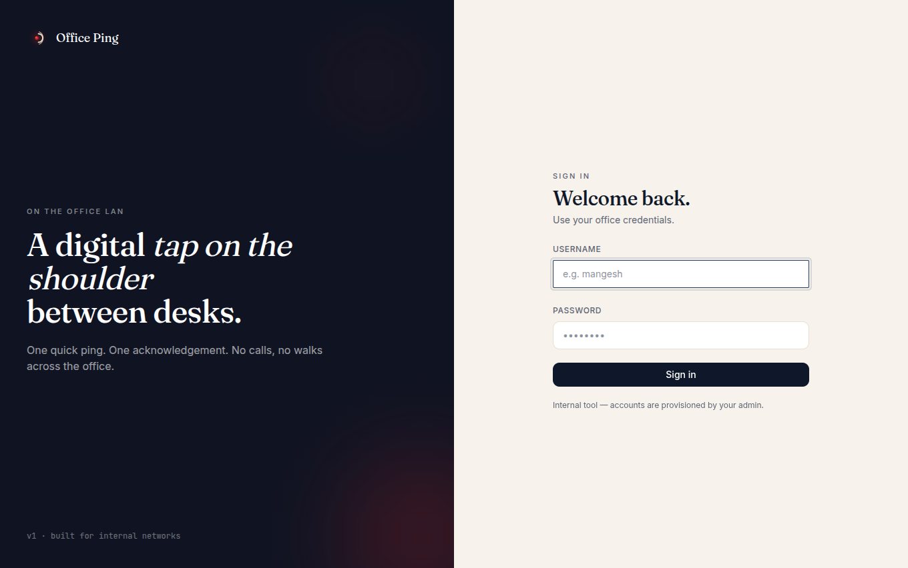 | |

**On a phone**

| | |
|---|---|
| 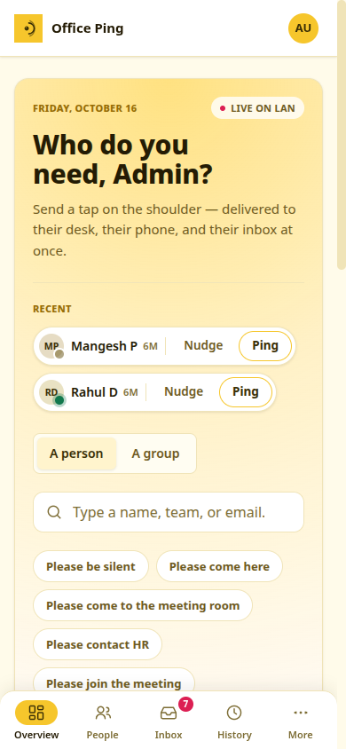 | 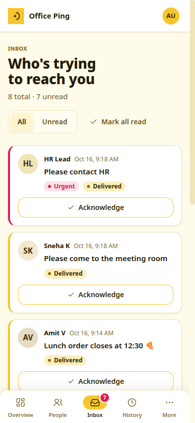 |

*All screenshots use the seeded demo data from `make seed`.*

## Tech stack

| Layer | Technology |
|---|---|
| Backend | Python 3.12, Django 5.2, Django REST Framework, Django Channels (Daphne), SimpleJWT |
| Data | PostgreSQL 16, Redis 7 (channel layer, cache, rate limits, sign-in lockout) |
| Frontend | Next.js 15 (App Router), React 19, TypeScript, Tailwind CSS, SWR, service worker (PWA) |
| Transport | REST under `/api/`, WebSockets under `/ws/` |
| Infrastructure | Docker Compose, nginx reverse proxy |

## Architecture

```
+----------+   HTTP(S)  +--------+   HTTP/WS    +-----------+
| Browser  | <--------> | nginx  | <----------> | backend   | Daphne: Django + Channels
| (PWA)    |            | :8080  |              +-----+-----+
+----------+            +---+----+                    |
                            |                   +-----+------+     +-----------+
                            v                   | postgres   |     | escalator | re-alerts
                     +------+-----+             | redis      |     | (manage.py| unacknowledged
                     |  frontend  |             +------------+     | escalate_ | urgent pings
                     |  Next.js   |                                | urgent)   |
                     +------------+                                +-----------+
```

- REST handles auth, users, groups, templates, pings, history, chat, dashboard and audit.
- WebSockets (`/ws/notifications/`, `/ws/presence/`) carry presence heartbeats and real-time delivery of pings, status changes and chat.
- The service worker shows OS-level notifications even when the tab is in the background.
- Each signed-in user is joined to their own channel-layer group; the server only ever addresses that group, so one user cannot subscribe to another's events.

Backend apps live in `backend/apps/` (`accounts`, `groups`, `templates`,
`notifications`, `chat`, `audit`, `common`). The frontend is in `frontend/`
(`app/` routes, `components/`, `lib/` for API and WebSocket clients). See
[docs/architecture.md](docs/architecture.md) for the request flow of a ping.

## Requirements

- Docker Engine 24+ with the Compose plugin
- About 2 GB of RAM for the stack
- For frontend development outside Docker: Node.js 20
- For backend development outside Docker: Python 3.12 plus a reachable PostgreSQL and Redis

## Quick start

```bash
git clone https://github.com/coderworkbench/office-ping.git
cd office-ping
cp .env.example .env     # defaults are fine for local development
make setup               # docker compose build
make dev                 # docker compose up -d
make seed                # demo users, groups and templates (dev only)
```

Then open <http://localhost:8080>. Migrations run automatically when the
backend container starts; `make migrate` runs them again on demand.

`make seed` creates these accounts and prints their shared demo password:

| User | Role |
|---|---|
| `admin` | ADMIN |
| `hr` | HR |
| `mangesh`, `rahul`, `sneha`, `amit` | MEMBER |

> [!WARNING]
> The demo password is in this public repository. Never run `make seed` on a
> server other people can reach, or change every seeded password straight
> away (`docker compose exec backend python manage.py changepassword <username>`).
> For a real deployment use `scripts/fresh-install.sh`, which creates one
> admin with a password you choose; see [docs/runbook.md](docs/runbook.md).

Useful addresses once it is running:

| URL | What |
|---|---|
| `http://localhost:8080/` | The app |
| `http://localhost:8080/api/me/` | API (returns `401` until you sign in) |
| `http://localhost:8080/django-admin/` | Django admin, for the `admin` account |

## Configuration

All configuration is read from `.env` (see [.env.example](.env.example) for
every variable with a comment). The ones you must change for anything beyond
local development:

| Variable | Purpose |
|---|---|
| `DJANGO_SECRET_KEY` | Long random string. `scripts/fresh-install.sh` generates one. |
| `POSTGRES_PASSWORD` | Database password used by the compose stack. |
| `DJANGO_ALLOWED_HOSTS` | Hostnames and IPs people will open, comma-separated. |
| `CORS_ALLOWED_ORIGINS`, `CSRF_TRUSTED_ORIGINS` | The same addresses, with scheme. |
| `DJANGO_DEBUG` | Keep `false` anywhere other than your own machine. |
| `SECURE_SSL_REDIRECT` | `true` only once HTTPS is terminated in front of the app. |

Behaviour knobs, all optional: `PING_RATE`, `PING_RATE_ELEVATED`,
`PING_RATE_PER_RECIPIENT`, `CHAT_RATE`, `CHAT_REACT_RATE`,
`URGENT_ESCALATE_AFTER_MINUTES`, `LOGIN_MAX_FAILURES_PER_USER`,
`LOGIN_MAX_FAILURES_PER_IP`, `LOGIN_LOCKOUT_SECONDS`, `TIME_ZONE`,
`ALLOW_MEMBERS_CREATE_GROUPS`. Details are in
[docs/administration.md](docs/administration.md).

## Development

Day-to-day commands (all wrap `docker compose`; see the `Makefile`):

```bash
make dev              # start the stack
make logs             # follow all container logs
make shell            # Django shell in the backend container
make makemigrations   # after changing a model; commit the result
make migrate
make down             # stop everything
scripts/reset-db.sh   # wipe the database and re-seed (asks first)
```

The backend image copies the source at build time, so rebuild after Python
changes: `docker compose up -d --build backend escalator`. To iterate on the
frontend with hot reload instead of the container:

```bash
cd frontend
npm install
NEXT_PUBLIC_API_URL=http://localhost:8080 npm run dev   # http://localhost:3000
```

### Tests

Backend tests (pytest with pytest-django) run inside the backend container
against the stack's PostgreSQL and Redis:

```bash
make test
docker compose exec backend pytest tests/test_pings.py -q   # one file
```

The suite covers authentication and lockout, roles and permissions, pings and
per-recipient delivery, rate limits, status and quick replies, escalation,
groups, templates, chat (REST and WebSocket), reactions, audit and the
bootstrap command, and checks that migrations match the models.

There are no frontend unit tests. `frontend/package.json` has a `test:e2e`
script for Playwright, but no Playwright config or scenarios are committed.

### Lint and type checks

```bash
make lint                        # backend compile check + frontend ESLint
cd frontend && npm run typecheck # TypeScript
```

The backend has no formatter configured; match the surrounding code. CI
([.github/workflows/ci.yml](.github/workflows/ci.yml)) runs the backend tests,
the migration check, ESLint, `tsc` and a production `next build` on every
push and pull request.

## API

Every endpoint is under `/api/` and, except sign-in, needs a JWT in
`Authorization: Bearer <token>`.

```bash
# Sign in (after `make seed`; the password is printed by that command)
curl -s -X POST http://localhost:8080/api/auth/login/ \
  -H 'Content-Type: application/json' \
  -d '{"username":"admin","password":"<demo password>"}'
# → {"access":"…","refresh":"…", …}

# Who am I?
curl -s http://localhost:8080/api/me/ -H "Authorization: Bearer $ACCESS"

# Send a ping to user 3
curl -s -X POST http://localhost:8080/api/pings/ \
  -H "Authorization: Bearer $ACCESS" -H 'Content-Type: application/json' \
  -d '{"recipient":3,"message":"Please come to reception","priority":"NORMAL"}'
```

The REST routes are declared in each app's `urls.py` under `backend/apps/`.
WebSocket authentication and message types are described in
[docs/websocket.md](docs/websocket.md); sign-in, tokens and lockout in
[docs/authentication.md](docs/authentication.md).

## Deployment

The compose stack publishes nginx on port 8080. For an office server:

- [docs/runbook.md](docs/runbook.md): step-by-step first installation on a LAN server.
- [docs/deployment-lan.md](docs/deployment-lan.md): internal DNS, HTTPS with your own CA, firewall.
- [docs/disaster-recovery.md](docs/disaster-recovery.md): `scripts/backup.sh`, `scripts/restore.sh`, and rebuilding a server from the repo plus one backup file. `scripts/server-setup.sh` prepares a fresh Ubuntu host (Docker, nginx, certbot).
- `docker-compose.prod.yml` and `deploy/docker-compose.override.server.yml` are overlays for a host that terminates HTTPS in its own nginx.

Browsers only allow desktop notifications and service workers on `localhost`
or HTTPS, so a real deployment needs TLS.

## Documentation

- [docs/user-manual.md](docs/user-manual.md): how to use Office Ping, for staff, HR and admins (also in the app under **Help**)
- [CHANGELOG.md](CHANGELOG.md): release history (also in the app under **Help → What's new**)
- [docs/architecture.md](docs/architecture.md), [docs/websocket.md](docs/websocket.md), [docs/notifications.md](docs/notifications.md), [docs/authentication.md](docs/authentication.md)
- [docs/administration.md](docs/administration.md), [docs/installation.md](docs/installation.md), [docs/troubleshooting.md](docs/troubleshooting.md)

Both `docs/user-manual.md` and `CHANGELOG.md` are generated from
`frontend/content/*.json` by `make manual`; edit the JSON, not the Markdown.

## Not included (yet)

- Web Push to closed browsers (needs VAPID keys; the notifier abstraction in
  `apps/notifications/services.py` leaves room for it).
- Password reset by email (there is no mail server; admins reset passwords from the UI).
- Frontend tests and Playwright end-to-end scenarios.

## Contributing

Pull requests are welcome. [CONTRIBUTING.md](CONTRIBUTING.md) covers setup,
branch naming, tests, lint and the pull request process. Please follow the
[Code of Conduct](CODE_OF_CONDUCT.md).

## Security

Found a vulnerability? Please report it privately through GitHub's
**Security → Report a vulnerability** rather than a public issue. See
[SECURITY.md](SECURITY.md).

## License

[MIT](LICENSE). The bundled Noto Sans font is under the SIL Open Font License
(`frontend/app/fonts/OFL.txt`).
