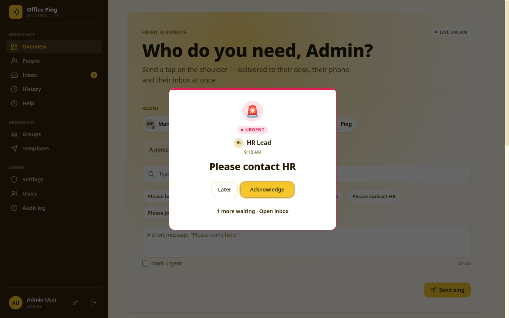
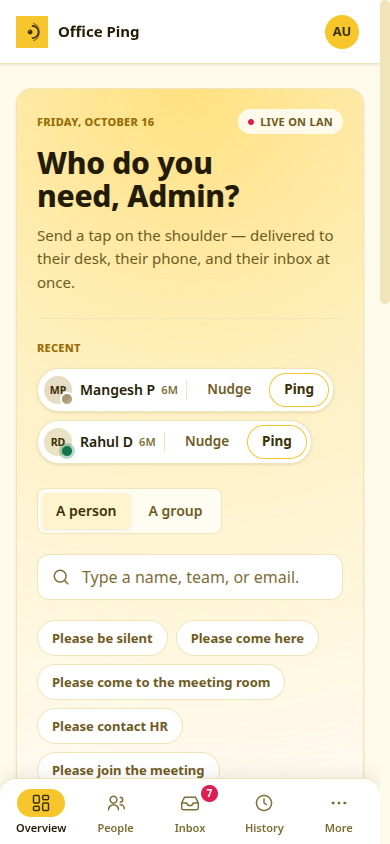
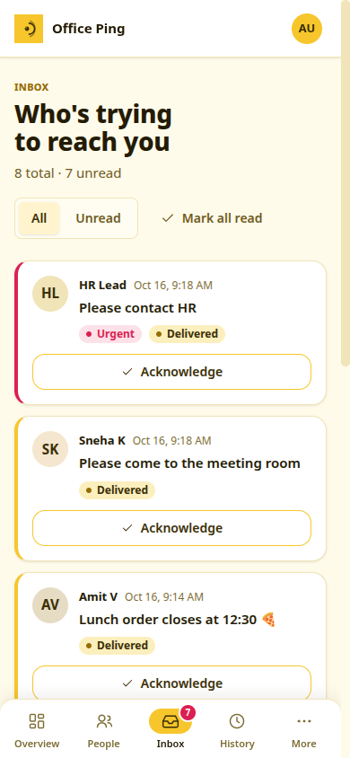

# Office Ping

An internal office notification / ping system for sending targeted alerts
to employees and groups over the office LAN. Supports real-time delivery via
WebSocket, PWA with desktop notifications, and acknowledgement tracking.



## Features

**Pinging**
- **Ping a person or a whole group**: one message reaches every member at once.
- **Nudge**: a one-click "👋 Nudge" for when you just need someone's attention.
- **Quick ping from anywhere**: Ctrl+K (⌘K) or `/` opens the composer on any page.
- **Quick templates**: canned messages like "Please come to the meeting room", managed by admins.
- **Recent recipients**: the people you pinged last sit on the dashboard for one-tap re-pinging.
- **Urgent priority**: urgent pings jump to the front, show as a pulsing red pop-up and play a distinct chime. If nobody acknowledges within 5 minutes, the pop-up comes back as a reminder and the sender is told.
- **Rate limiting**: 5 pings a minute per person (a group ping counts once), so nobody can spam the office. Configurable with `PING_RATE` / `PING_RATE_ELEVATED`.
- **No bombarding**: at most 2 pings a minute to the same person, and the same message can't be sent to them twice within a minute (`PING_RATE_PER_RECIPIENT`). Blocked attempts appear in the audit log.

**Delivery and acknowledgement**
- **Hard-to-miss alerts**: an incoming ping opens a pop-up in the middle of the screen that stays until it's acknowledged or put off with *Later*. Several pings queue up, and the tab title keeps flashing while any are waiting.
- **Desktop notifications** through the service worker, even when the tab is in the background. They stay on screen until clicked, clicking one brings Office Ping to the front, and they close by themselves once the ping is handled.
- **Offline-safe**: pings sent while someone is away are delivered as soon as they reconnect.
- **Per-recipient tracking**: every ping moves through *Sent → Delivered → Seen → Acknowledged*, per recipient for group pings.
- **Quick replies**: answer with *On my way*, *Coming in 2 min*, *In a meeting* or *Can't right now*; the sender sees the reply instantly.
- **Tidy inbox**: repeated pings collapse into one row (*👋 Nudge ×8*), and unanswered urgent pings are pinned to the top.
- **Installable PWA** with its own icons and manifest.
- **Opens at sign-in**: one-click setup files for Windows, macOS and Linux (Help → *Open Office Ping automatically at start-up*) open Office Ping in its own window whenever a computer starts, so nobody misses pings.

**Chat**
- **Messages**: quiet one-to-one chat alongside pings. On a computer, a LinkedIn-style bar in the bottom-right corner opens your chats in small windows; on a phone, Messages has its own tab.
- **Seen and typing…**: read receipts and a typing indicator, live over the same connection as pings.
- **Never noisy**: no pop-up or sound, a desktop notification only when the chat isn't in front of you, nothing while you're in a meeting or on Do Not Disturb, and a per-chat mute. Need attention now? **Ping** from inside the chat.
- **Private**: only the two people can read a chat; the audit log records that a chat started, never its content. `CHAT_RATE` limits messages per minute (default 30).

**People and presence**
- **Live presence**: see who is online right now, with a heartbeat-based status.
- **Status and Do Not Disturb**: *In a meeting*, *Do not disturb*, *Out for lunch* or *Away*, with an end time. Senders see it before they ping; in a meeting or DND, normal pings wait quietly in the inbox while urgent ones still break through.
- **Searchable directory** by name, team or email.

**Administration**
- **Roles**: *Admin*, *HR* and *Member*, with permissions enforced on the server.
- **User management**: create, deactivate and change the role of users from the UI.
- **Passwords**: everyone can change their own password (key icon in the sidebar), and admins can reset a forgotten one with a generated, easy-to-read password.
- **Groups and templates** management.
- **Audit log** of sign-ins (and failed ones), password changes and resets, user/group/template changes, and every ping sent, acknowledged, escalated or exported, with actor and IP.
- **Ping history** with search and filters (person, dates, status, urgent), *Sent*, *Received* and *All* (HR and admins), plus CSV export for admins.
- **Sign-in protection**: a username locks for 15 minutes after 5 wrong passwords.

**Design**
- **Sunbeam theme**: the TGF design system (warm cream, gold accent, Noto Sans), shared with Khoji Connect.
- **Built-in help**: a Help page with animated, step-by-step demos of each task, and a guided tour that spotlights the real controls (offered once on first sign-in, replayable from Help).
- **Responsive**: a navigation rail on desktop; on phones and tablets a bottom tab bar, bottom-sheet dialogs and card layouts instead of wide tables. On a phone the Overview is a one-screen composer (tap a face, pick a quick message, Send; press and hold to nudge) whose Send button stays above the keyboard. Large tap targets, keyboard focus rings and reduced-motion support.

**Deployment**
- **One `docker compose` stack**: Postgres, Redis, Django/Daphne, Next.js, nginx and a small escalation worker.
- **Built for a LAN**: no external services or cloud accounts needed. See [deployment-lan.md](docs/deployment-lan.md).
- **Backups and recovery**: `scripts/backup.sh` (daily via cron) and `scripts/restore.sh` bring everything back on a fresh server; `scripts/fresh-install.sh` starts clean with the repo's templates and a new admin. See [disaster-recovery.md](docs/disaster-recovery.md).

## Screenshots

| | |
|---|---|
| **Incoming ping pop-up (urgent)**<br> | **Dashboard**<br> |
| **People and live presence**<br> | **Ping dialog with quick templates**<br> |
| **Inbox**<br> | **History with delivery and ack status**<br> |
| **Groups**<br> | **Templates**<br> |
| **User management (admin)**<br> | **Audit log (admin)**<br> |
| **Sign in**<br> | |

**On a phone**

| | |
|---|---|
|  |  |

*All screenshots use the seeded demo data from `make seed`.*

## Stack

- **Backend:** Django 5, Django REST Framework, Django Channels, PostgreSQL, Redis
- **Frontend:** Next.js 14 (App Router), TypeScript, Tailwind CSS with the Sunbeam design tokens, PWA (service worker)
- **Transport:** REST for CRUD + history, WebSocket (`/ws/notifications/`, `/ws/presence/`) for real-time
- **Infra:** Docker Compose, nginx reverse proxy

## Quick start (dev)

```bash
cp .env.example .env         # edit DJANGO_SECRET_KEY etc.
make setup
make dev
make migrate
make seed
```

Then open `http://localhost:8080` and log in with the seeded demo credentials
(see output of `make seed`).

| User       | Role   |
|------------|--------|
| `admin`    | ADMIN  |
| `hr`       | HR     |
| `mangesh`  | MEMBER |
| `rahul`    | MEMBER |
| `sneha`    | MEMBER |
| `amit`     | MEMBER |

Dev password for all seeded users is printed by `make seed`.

> [!WARNING]
> The demo password is in this public repository. Never run `make seed` on a
> server other people can reach, or change every seeded password straight away
> (`python manage.py changepassword <username>`). For production, create real
> accounts as described in [runbook.md](docs/runbook.md).

## Architecture

```
+----------+   HTTPS   +--------+   HTTP/WS    +---------+
| Browser  | <-------->| nginx  | <----------->| backend | (Daphne, Django+Channels)
| (PWA)    |           +--------+              +----+----+
+----------+               |                        |
                           v                        v
                    +------+-----+            +-----+------+
                    |  frontend  |            | postgres   |
                    |  (Next.js) |            |  redis     |
                    +------------+            +------------+
```

- REST handles auth, users, groups, templates, pings, history, dashboard, audit.
- WebSockets handle presence heartbeats and real-time delivery of pings + status.
- Service worker surfaces OS-level notifications even when the tab is backgrounded.
- Notification delivery goes through a service abstraction so a `WebPushNotifier`
  can be added later without touching ping logic.

See `docs/` for deeper topics:

- [user-manual.md](docs/user-manual.md): how to use Office Ping, for staff, HR and admins (also in the app under **Help**)
- [architecture.md](docs/architecture.md)
- [installation.md](docs/installation.md)
- [deployment-lan.md](docs/deployment-lan.md)
- [authentication.md](docs/authentication.md)
- [notifications.md](docs/notifications.md)
- [websocket.md](docs/websocket.md)
- [administration.md](docs/administration.md)
- [troubleshooting.md](docs/troubleshooting.md)
- [disaster-recovery.md](docs/disaster-recovery.md): backups, and rebuilding the server from the repo plus one backup file

## Tests

```bash
make test
```

## Status / scope

This repository is a production-ready scaffold with all the core workflows
listed in the spec: auth, roles, device registration, presence, individual
and group pings with per-recipient delivery/ack tracking, templates, audit
logs, dashboard, PWA + service worker, Docker/nginx deployment, seed data,
and backend tests covering auth, permissions, pings, groups, templates, and
audit.

Items intentionally **not** included at this stage:

- Web Push (requires VAPID keys and a signed push server; the architecture
  leaves a clean seam for `WebPushNotifier` to be added).
- Playwright E2E tests (configuration provided, scenarios are listed in
  `docs/troubleshooting.md` and the DOD scenarios in the spec).
- Password reset email (code path is documented in `authentication.md`).
- TLS automation (compose exposes `:80`; use `docker-compose.prod.yml` and
  mount certs into nginx for internal HTTPS — see `deployment-lan.md`).
